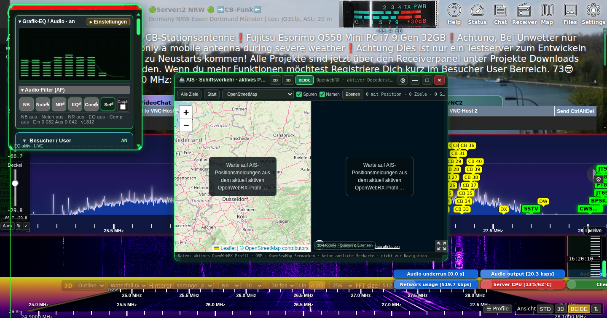
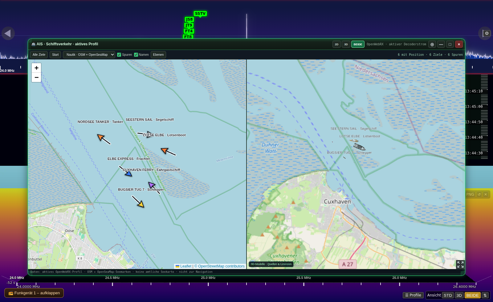
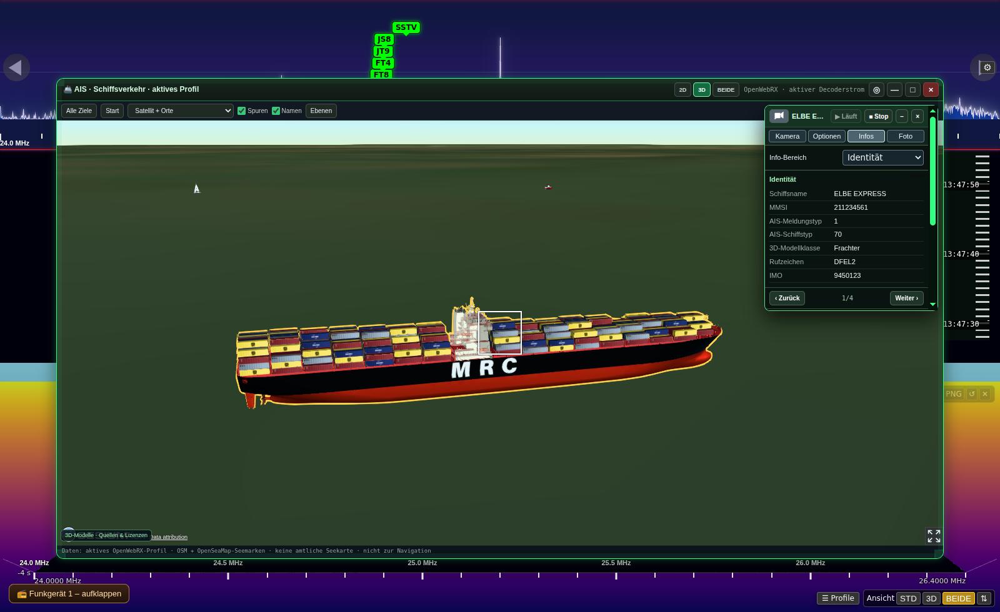
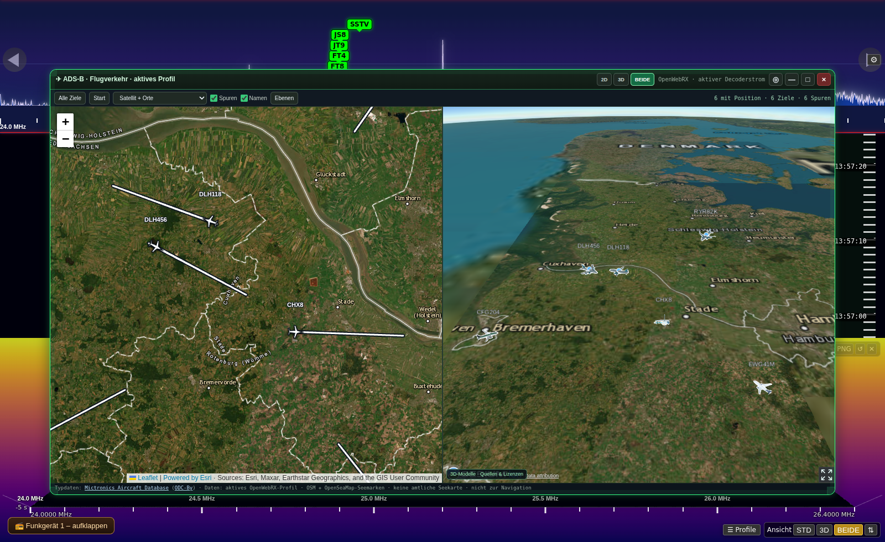
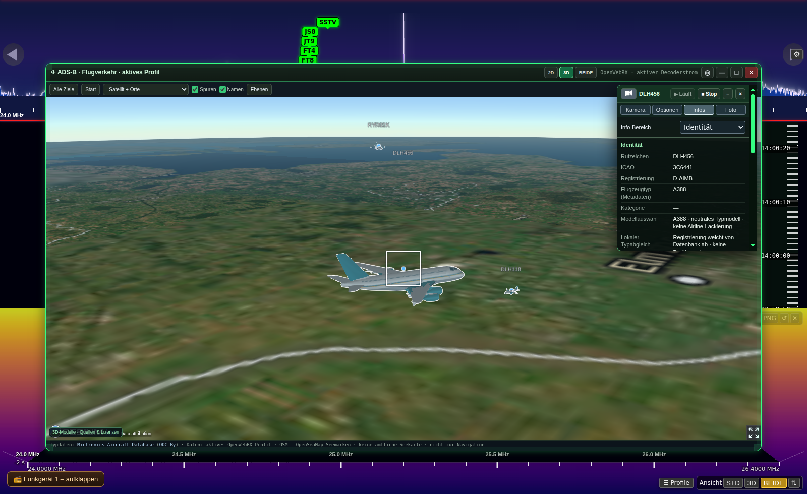
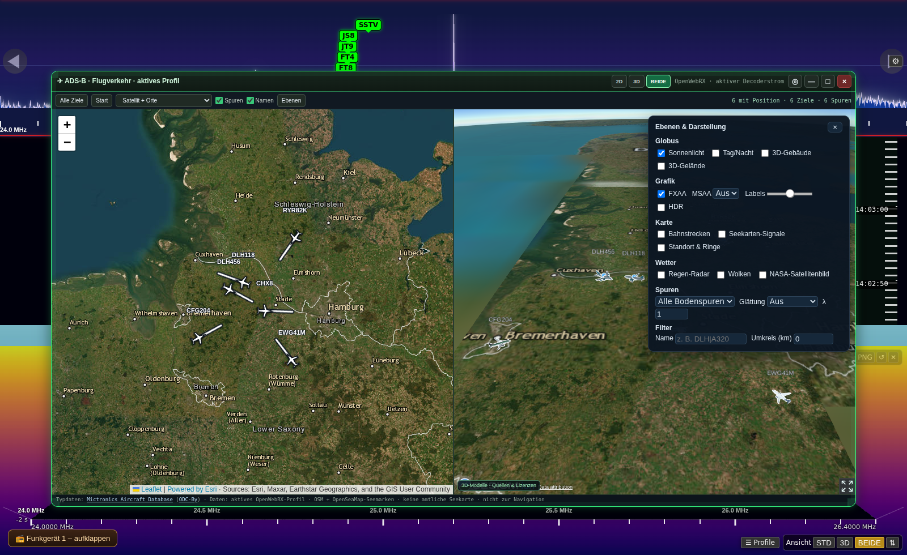
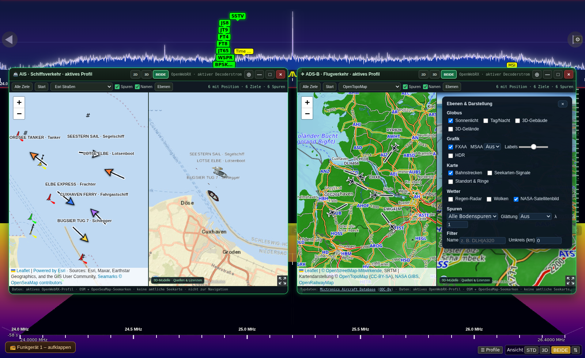
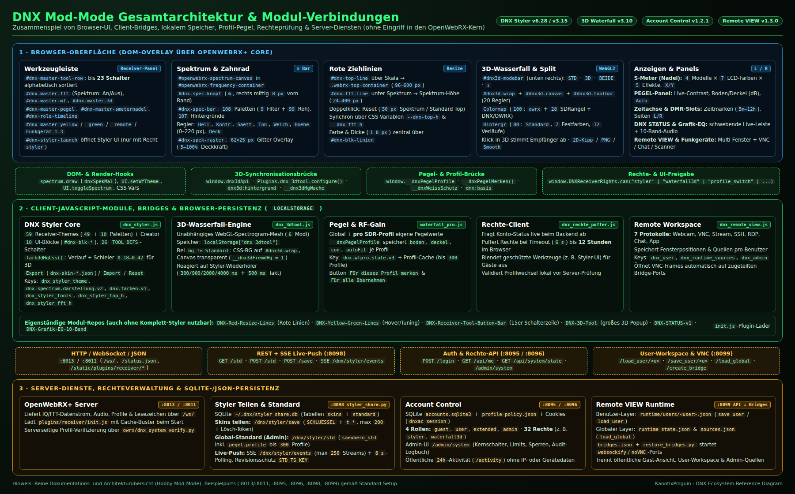
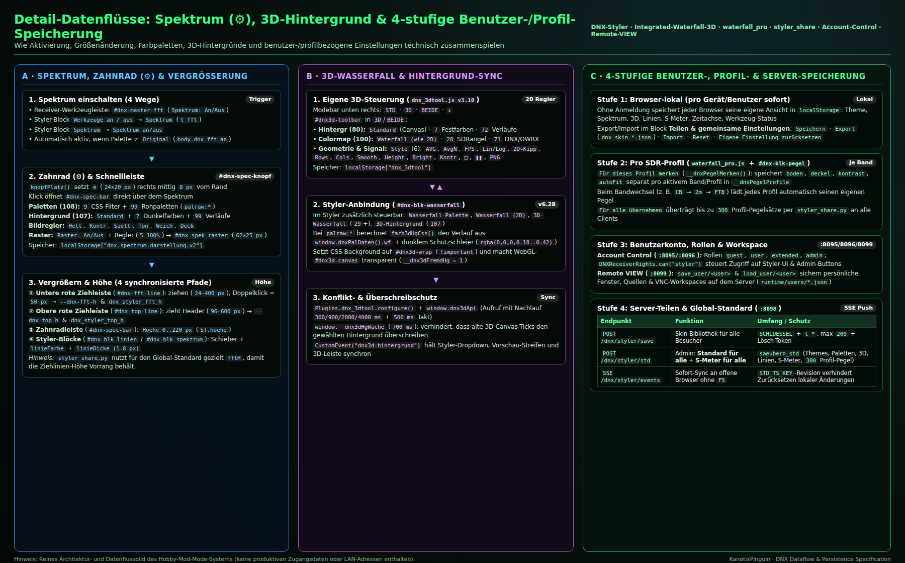

# DNX AirMarine AIS/ADS-B (`v4.17`)

<!-- DNX-DISCLAIMER-START -->
> **Wichtiger Hinweis / Vollständige Distanzierung (Hobby-Mod-Mode)**
>
> - **Vollständige Distanzierung:** Ich distanziere mich in jeder Hinsicht vollständig vom Projekt **OpenWebRX / OpenWebRX+** sowie dessen Entwicklern und Betreibern. Es besteht keinerlei Verbindung, Zusammenarbeit, Prüfung, Befürwortung oder Partnerschaft.
> - **Keine öffentlichen/offiziellen OpenWebRX-Plugins (nur Mod-Mode):** Bei diesem Projekt handelt es sich ausdrücklich **nicht** um ein öffentliches oder offizielles Plugin von OpenWebRX, sondern ausschließlich um einen privaten, inoffiziellen **Mod-Mode** (Eigenmodifikation).
> - **Warum bewusst kein reines Browser-JavaScript (Mod-Mode-Architektur):** Viele Funktionen (z. B. serverseitige Speicherung, Konten-/Rollenverwaltung, Profil-Synchronisation, VNC-/websockify-Brücken, geschützte Schnittstellen, Docker-/Systemintegration und stabile UI-Anpassungen) lassen sich sauber und sicher nicht allein über simples Client-JavaScript umsetzen, ohne den OpenWebRX-Kern umzubauen oder Browsergrenzen zu umgehen. Deshalb setzt dieses Projekt bewusst auf getrennte Begleitmodule, Shell-Installer und Dienste im **Mod-Mode** statt alles künstlich in reines JavaScript zu pressen.
> - **Kein öffentlicher Support & keine Haftung:** Es gibt **keinen öffentlichen Support**, keine Garantie und keine Haftung. Nutzung, Installation und Anpassung erfolgen vollständig auf eigene Gefahr (immer vorher Backups anlegen und zunächst im eigenen Testsystem prüfen).
> - **Reines Hobbyprojekt – frei nutzbar, änderbar & verbreitbar:** Dieses Projekt entsteht ausschließlich aus reinem Hobby und Interesse am gemeinsamen Funk-/SDR-Hobby. Es steht ausdrücklich frei zur Verfügung und darf frei genutzt, weiterverbreitet, verändert und verbessert werden.
<!-- DNX-DISCLAIMER-END -->

> **Important Notice / Full Disassociation (Hobby Mod-Mode Only)**
>
> - **Full Disassociation:** I completely disassociate myself from **OpenWebRX / OpenWebRX+** and its developers/maintainers. There is no affiliation, endorsement, review, or partnership of any kind.
> - **No Official/Public OpenWebRX Plugins (Mod-Mode Only):** These files are **not** official or public OpenWebRX plugins, but purely unofficial hobby modifications (*mod-mode*).
> - **Why Not Everything in Pure Browser JavaScript:** Many features (server-side persistence, account/role management, profile syncing, VNC/websockify bridges, protected endpoints, and Docker/host integration) cannot be implemented cleanly or reliably in client-side JavaScript alone without modifying the OpenWebRX core or hitting browser/security limits. That is why this project intentionally uses separate companion scripts, services, and *mod-mode* hooks rather than forcing everything into pure JS.
> - **No Public Support & No Warranty:** There is **no public support**, no warranty, and no liability. Use entirely at your own risk.
> - **Pure Hobby Project — Free to Use, Modify & Redistribute:** Created solely out of personal hobby interest in the shared radio/SDR hobby; freely available to use, share, modify, and improve.

<!-- DNX-PREVIEW-START -->
## Live-Vorschau & Galerie (`DNX AirMarine AIS/ADS-B`)

| Ansicht | Beschreibung | Screenshot |
|---|---|---|
| **AIS & ADS-B Gesamtansicht** | Parallelbetrieb von AIS (`Nautik · OSM + OpenSeaMap`, Cuxhaven/Elbe) & ADS-B (`Satellit + Orte`, Norddeutschland) in `BEIDE` (2D + 3D Cesium) |  |
| **AIS 2D + 3D Cesium** | Schiffsverkehr mit 6 Schiffsklassen (`Container`, `Tanker`, `Fähre`, `Schlepper`, `Lotsenboot`, `Segelschiff`), kurzen Spuren & realer Küste |  |
| **AIS Folgeansicht & Details** | Aktive 3D-Verfolgungskamera (`▶ Läuft`) auf `ELBE EXPRESS` samt `Infos`-Panel (`Identität 1/4`: MMSI, IMO, Rufzeichen) |  |
| **ADS-B 2D + 3D Cesium** | Flugverkehr (`DLH456`, `DLH118`, `CFG204`, `CHX8`, `RYR82K`, `EWG41M`) mit `Satellit + Orte`, Höhen-3D-Modellen & Bodenspuren |  |
| **ADS-B Folgeansicht & Details** | 3D-Verfolgung (`▶ Läuft`) eines `A380` (`DLH456`) samt Mictronics-Typabgleich & Registrierung (`D-AIMB`) |  |
| **Ebenen & Darstellung** | Einstellungs-Popover: `Globus` (Sonnenlicht, Tag/Nacht, 3D-Gebäude/-Gelände), `Grafik` (FXAA, MSAA, Labels, HDR), `Karte`, `Wetter`, `Spuren` & `Filter` |  |
| **Kartenstile & Wetter-Overlays** | `Esri Straßen` + `Seekarten-Signale` (links) und `OpenTopoMap` + `Bahnstrecken` + `NASA-Satellitenbild` mit geöffneter Ebenen-Auswahl (rechts) |  |
<!-- DNX-PREVIEW-END -->

Browser-side AIS/ADS-B add-on for compatible OpenWebRX+ installations. **Release v4.17 — published in the DNX Projects catalog.**

## Funktionsumfang (`v4.17`) — Verfolgung, Tracking, Bilder & Wetter-Ebenen

Getrennte, frei verschieb- und skalierbare Live-Fenster für **AIS (Schiffsverkehr)** und **ADS-B (Flugverkehr)** in den Ansichtsmodi **`2D`** (Leaflet), **`3D`** (CesiumJS 1.121) und **`BEIDE`** (Split-Ansicht):

- **Verfolgung, Tracking & Live-Beobachtung (2D & 3D):**
  - **Echtzeit-Bewegung von A nach B (`v4.17`):** Kontinuierliches Gleiten zwischen Empfangsmeldungen inklusive zeitlich begrenzter 60-s-Extrapolation in 2D und 3D; Bewegungsproben werden erst ab echter Ortsänderung erfasst.
  - **3D-Folgeansicht / Kameraverfolgung:** Start per Rechtsklick oder im Info-Panel (`Mitfahren / Verfolgen`, Live-HUD mit Kurs, Höhe, Geschwindigkeit & **Distanz zum Empfänger-Standort**). Frei schwenkbare Kamerabahn, Kamera-Voreinstellungen (`Hinten`, `Seite`, `Vorne`, `Oben`), wählbarer `Kamera-Abstand` (`100 m` bis `3 km`), zuschaltbare **`360°`-Kameradrehung (Auto-Umlauf)**, mitwandernde 2D-Karte und rein visueller, jederzeit zurücksetzbarer **Modell-Offset**.
  - **Spuren, Glättung & Wiedergabe (Replay):** Bodenspuren wahlweise für `Alle Ziele`, `Nur Folgeziel` oder `Keine`, konfigurierbare **Spurfarbe**, optionale **Whittaker-Eilers-Spurenglättung** (`5`, `10` oder `20` Punkte, frei wählbares `λ`) sowie **Spur abspielen / Replay** gespeicherter Routen.
  - **Filter & Zielbeobachtung:** Live-Filterung nach Name, Flugnummer oder Typ (`Regex`) sowie **Umkreisfilter (km)** bezogen auf den Empfänger-Standort, **Positionsringe** um den Empfänger, `Alle Ziele` (verkehrsabhängiges Einpassen) und `Start`-Rücksprung.
- **Bilder / Fotos & mehrseitige Ziel-Details:**
  - **Live-Fotos & `Typbild`-Abgleich:** Automatische **Wikimedia-Commons-Fotosuche** im eigenen **`Foto`-Tab** des Infos-Panels — bei Schiffen über `IMO → Schiffsname → MMSI`, bei Flugzeugen über `Registrierung → ICAO-Hex → Flugzeugtyp`, jeweils mit klarer Kennzeichnung (`Schiffsfoto` / `Foto` bzw. `Typbild`) und sichtbarer Autoren-/Lizenzangabe sowie Direktlinks (`ADSB.lol`, `ADS-B Exchange`, `Planespotters`, `JetPhotos`, `Flightradar24`, `FlightAware`, `Wikimedia Commons`).
  - **4-seitiges Infos-Panel:** Umschaltbare Detailansichten (`Identität`, `Position`, `Bewegung`, `Schiff`/`Flugzeug` inkl. Mictronics-Typabgleich), separater `Kamera`- und `Optionen`-Reiter sowie `Flugzeuggröße`-Multiplikator (`1×` bis `3×`).
- **Wetter-, Karten- & Globus-Ebenen (`Ebenen & Darstellung`):**
  - **Wetter-Overlays:** Zuschaltbares **Regen-Radar** (`RainViewer`), animierte **Wolken**-Schicht und **NASA-Satellitenbild** (`NASA GIBS MODIS TrueColor`, jeweils ohne eigenen API-Schlüssel).
  - **7 schlüssellose Kartenstile & Zusatzlayer:** `OpenStreetMap`, `Esri Satellit`, `Esri Straßen`, `OpenTopoMap`, `Carto Hell`, `Carto Dunkel` und `Nautik · OSM + OpenSeaMap`, kombiniert mit **Seekarten-Signalen (`OpenSeaMap`)** und **Bahnstrecken (`OpenRailwayMap`)**.
  - **3D-Globus & Grafik (`CesiumJS 1.121`):** Zuschaltbares `Sonnenlicht`, `Tag/Nacht`-Beleuchtung, `3D-Gelände`, `3D-Gebäude`, `FXAA`, `MSAA` (`Aus`, `2×`, `4×`), `HDR` und stufenloser `Labels`-Größenregler.
- **24 lokal ausgelieferte CC-BY-4.0-3D-Klassenmodelle:** 14 Schiffsklassen (`Container`, `Tanker`, `LNG`, `Bulk`, `Kreuzfahrt`, `Fähre`, `Kleine Fähre`, `Navy`, `Lotsenboot`, `Segelschiff`, `Yacht`, `Runabout`, `Schlepper`, `Fischerei`) und 10 Flugzeugklassen (`A320`, `A350`, `A380`, `B737`, `B787`, `eVTOL`, `Drone`, `F-15`, `ASK 21`, `Helicopter`).

> **Abgrenzung zu `DNX MultiSDR`:** Dieses OpenWebRX+-Mod-Mode-Paket enthält bewusst **keine** Sprachausgabe (`Sprache`-Tab), **keine** Mikrofon-Sprachsteuerung, **keinen** Blitz-Alarm und **kein** Browser-GPS (`navigator.geolocation` — Distanz- und Umkreiswerte beziehen sich auf den konfigurierten Empfänger-Standort). Sprachansagen bei ADS-B (`Sprache`-Tab mit Notfall-/Umkreis-Alarm), GPS-Standortübernahme, Cockpit-/Route-Verfolgung, Blitzalarm mit Sprache/Ton, Gewitter-/Nowcast-Vorhersagebilder und Mikrofon-Sprachsteuerung (`dnx-befehl.js`) sind Bestandteil des separaten Systems **DNX MultiSDR**.

## What v4.17 contains — movement from A to B, fixed

v4.16's glide machinery was right, but a sampling bug froze it: every sync tick recorded a new motion sample even when the position had not changed (list re-broadcasts, altitude jitter). The velocity of the last two samples was diluted to zero, so targets never travelled from A to B. v4.17 records a motion sample **only when the target has really moved** (same ~3 m threshold as the trail), in both the 3D sampled positions and the 2D motion pairs. Now ships and aircraft visibly travel along their routes and glide continuously between reports — like SDRangel.

Everything else from v4.13–v4.16 is included: photo slideshow with „Typbild" caption, 50 px aircraft size, traffic-aware zoom, satellite + 6 keyless map styles, sun light, day/night, 3D buildings/terrain, FXAA/MSAA/HDR, label scale, rain radar + cloud animation + NASA imagery, ground tracks, Whittaker-Eilers smoothing, name/distance filters, smooth motion for ships and aircraft, target pursuit camera with lock-on silhouette, map pan-along, live follow HUD, railways, seamarks, position rings, and track replay. (Voice alerts/TTS, microphone voice control, lightning alarms, and browser `navigator.geolocation` are not part of this OpenWebRX+ add-on; they live in the separate **DNX MultiSDR** platform.)

## Aircraft sources and model-size calibration

Seven no-logo models are from amvlab's [`aircraft-models`](https://github.com/amvlab/aircraft-models/tree/91d835e8e851b2317fe79af291c9fed6153fd525) repository at commit `91d835e8e851b2317fe79af291c9fed6153fd525`, CC BY 4.0. The helicopter, glider, and F-15 are CC BY 4.0 models by Gigantic Burger, helijah, and PolyDucky, respectively, distributed via [SDRangel 3D Models](https://github.com/srcejon/sdrangel-3d-models/tree/59d1ee24ebc2c24343afb54b26928f965a625140) at commit `59d1ee24ebc2c24343afb54b26928f965a625140`. See `dnx_airmarine_3d/models/adsb-realistic/credits.html` for visible per-model attribution.

Bounds below are measured from GLB POSITION accessors after applying the full glTF node transform tree, then the runtime class scale. Axes are the model-file X/Y/Z bounds; they are not a browser-render verification.

| Model | Source X × Y × Z bounds (metres, scaled) | Runtime scale | Nominal camera dimension |
| --- | ---: | ---: | ---: |
| A320 | 37.68 × 11.32 × 35.48 | 1.00 | 38 m |
| A350 | 67.41 × 17.19 × 67.47 | 1.00 | 67 m |
| A380 | 73.90 × 22.28 × 80.42 | 0.42 | 80 m |
| B737 | 37.87 × 11.88 × 35.74 | 1.00 | 38 m |
| B787 | 56.58 × 16.32 × 58.01 | 1.00 | 58 m |
| eVTOL | 5.12 × 1.96 × 7.08 | 5.00 | 7 m |
| Drone | 0.82 × 0.37 × 0.66 | 1.00 | 1 m |
| F-15 | 14.46 × 5.29 × 21.94 | 1.00 | 22 m |
| ASK 21 glider | 17.01 × 2.37 × 8.34 | 1.00 | 17 m |
| Helicopter | 16.51 × 6.34 × 19.91 | 1.00 | 20 m |

The A380's original imported bounds were roughly 2.4× too large, so it is corrected to 0.42×. The eVTOL source mesh is about one metre across, so it is scaled 5× to a representative 5–7 m aircraft. The seven amvlab models use +X forward; the SDRangel glTFs use +Z forward. The Cesium forward-axis option is selected per asset. The test suite checks the transformed bounds and class scales.

**Validation note:** offline JavaScript regressions, source checks, GLB structure/provenance, and node-transform dimension checks pass. The zoom behaviour and the motion pipeline (sampled positions, 60 s linear extrapolation, single-sample hold, clock-driven rendering, primitive ticker) have been verified end-to-end in headless Chrome against the receiver's Cesium vendor build and by the offline regression suite (smoothing, filters, track modes, layer catalogue, ticker wiring). The Commons photo queries have been checked against the live API; RainViewer and NASA GIBS endpoints are the public documented services SDRangel also uses. The ten aircraft GLBs themselves still await a visual orientation/size check on the target receiver.

## Package contents

- `dnx_styler.js` — v4.17 Styler with the matching loader cache-buster.
- `dnx_stand.txt` — matching version/size stamp: `v4.17 614560`.
- `dnx_airmarine_3d/dnx_airmarine_3d.js` — AirMarine frontend module.
- `dnx_airmarine_3d/models/ais-realistic/` — the 14 CC BY 4.0 ship models and their credits.
- `dnx_airmarine_3d/models/adsb-realistic/` — ten CC BY 4.0 aircraft models, source/license notices, credits, manifest, and checksums.
- `tests/` — offline AIS/ADS-B regression test and model/provenance/dimension integrity check.
- Top-level `SHA256SUMS.txt` — package file checksums, excluding the checksum file itself.

## Runtime dependencies and installation notes

The receiver must already provide CesiumJS at `/static/plugins/receiver/dnx_weather/vendor/cesium/`, Leaflet at `/static/plugins/receiver/dnx_weather/vendor/leaflet/`, and the active profile's existing AIS/ADS-B data streams. The package expects and does **not** replace the receiver's existing fallback assets:

- `dnx_airmarine_3d/models/aircraft/Cesium_Air.glb` — required ADS-B fallback.
- `dnx_airmarine_3d/models/ais/` — legacy AIS fallback class models.

Photos load at runtime from Wikimedia Commons and need internet access in the browser; without it the info panels simply show „Kein Bild gefunden".

---

## Verbindungen im DNX-Ökosystem

* **Verbindung zu `DNX-Styler` (`#dnx-master-tool-row` & `TOOL_DEFS`):** Die Werkzeuge `ADS-B` (`t_adsb` / `#dnx-master-adsb`) und `AIS` (`t_ais` / `#dnx-master-ais`) binden sich in die gemeinsame Empfänger-Werkzeugzeile ein; Einstellungen und Overlay-Zustand liegen unter `localStorage["dnx.airmarine.*"]` / `dnx.receiver.overlay.visible`.
* **Verbindung zu `DNX-Receiver-Account-Control` (`:8095/api/me`):** Die Berechtigungen `adsb_view`, `adsb_control`, `ais_view` und `ais_control` steuern rollenbasiert die Sichtbarkeit und Eingaberechte für `guest`, `user`, `extended` und `admin`.
* **Verbindung zu `DNX-Receiver-Tool-Button-Bar` & `OWRXP-DNX`:** Alle Schaltflächen passen sich automatisch den gemeinsamen Button-Farben und dem Styler-Design (`dnx_styler_corners`) an.
